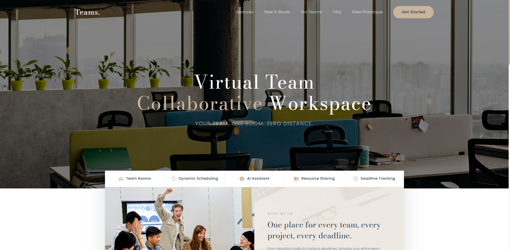
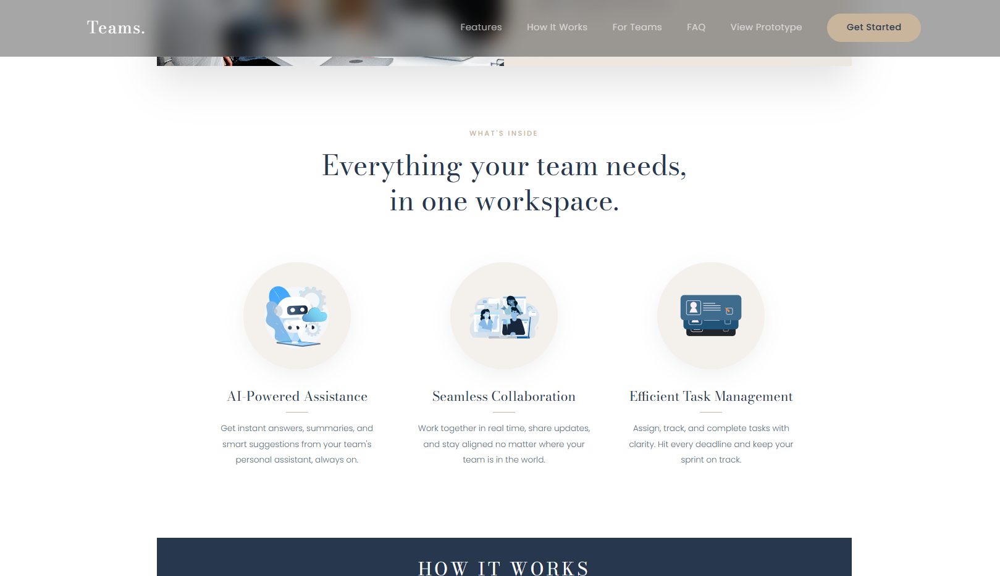
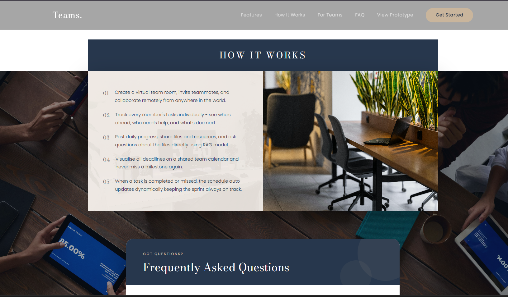
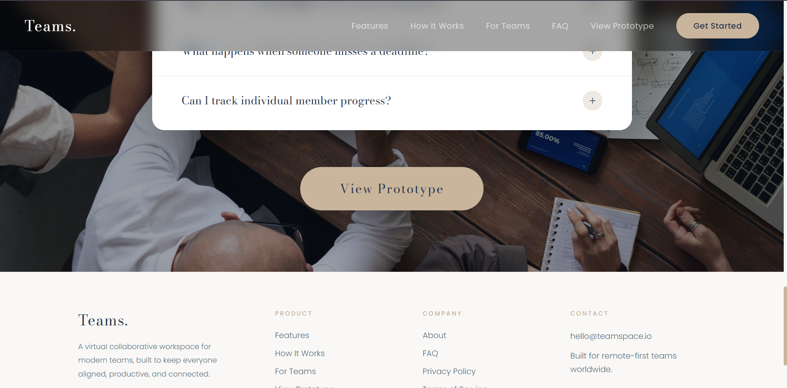
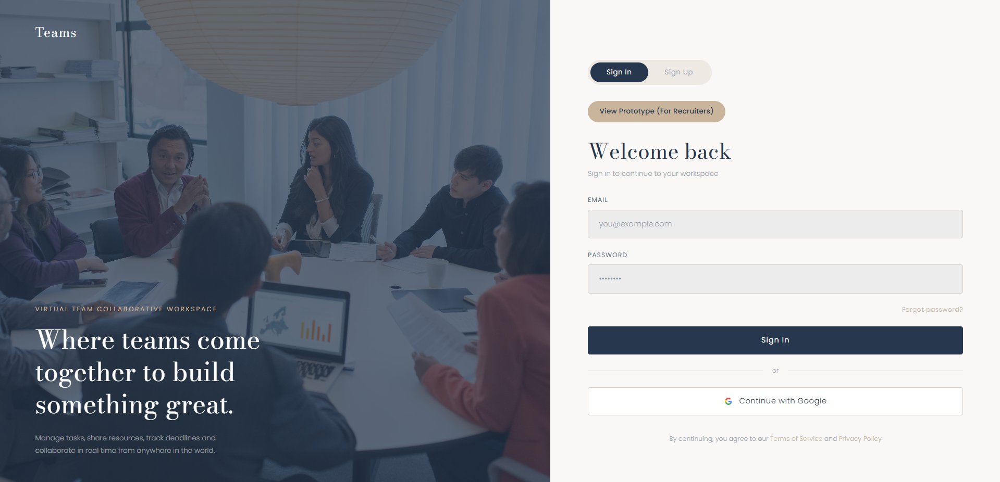
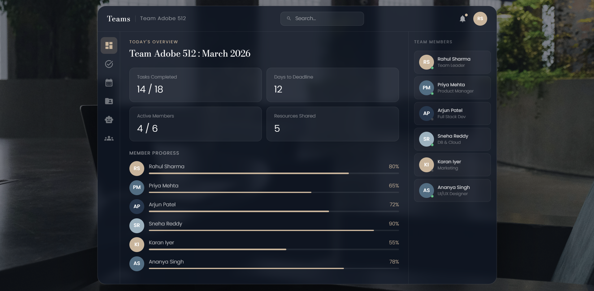
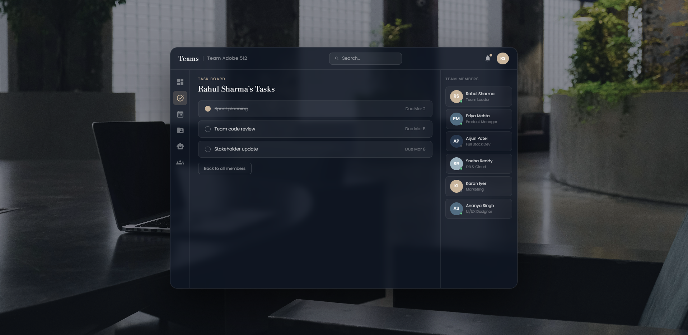
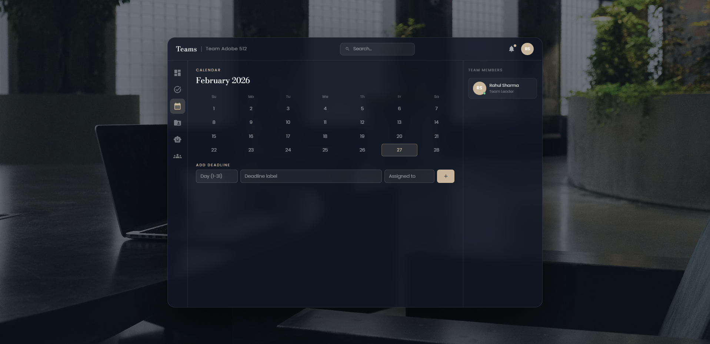
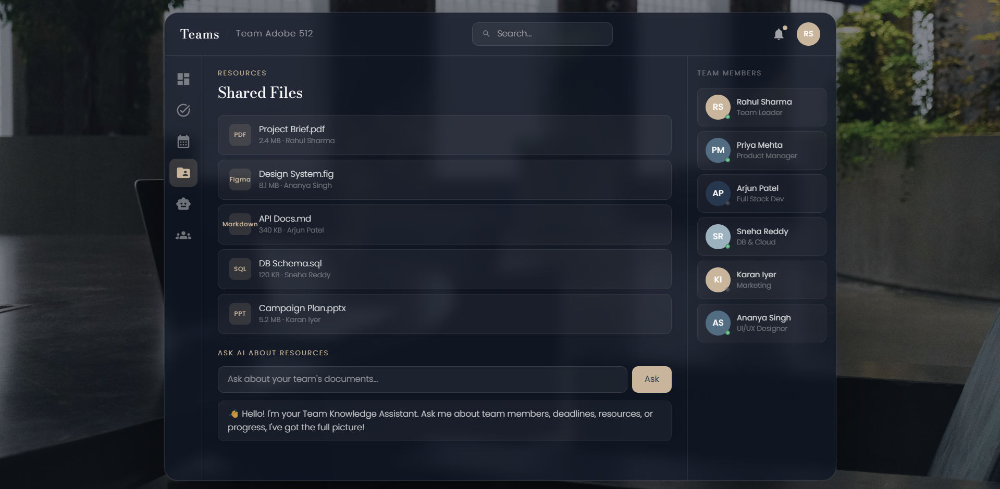
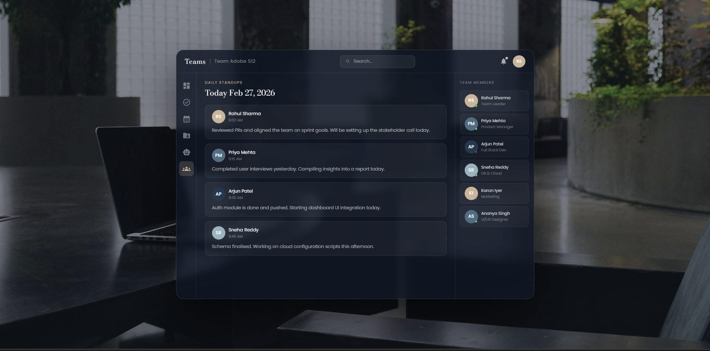

# Virtual Team Collaborative Workspace (Python Full Stack)

## Deployed Website

https://virtual-team-collaborative-system-p.vercel.app/

## Screenshots

<!-- Add your screenshots to the screenshots folder in the project root.
     Replace the filenames below with your actual image filenames. -->

## What is VTCW?

Virtual Team Collaborative Workspace (VTCW) is a full-stack web application built for students and professionals working in distributed teams. It provides a single unified platform where team members can manage tasks, share resources, track deadlines, post daily standups, and access an AI assistant interface, all from one glassmorphism-styled dashboard.

The platform simulates real-world team collaboration workflows, making it ideal for academic project teams, internship cohorts, and remote working professionals.

---

## Deployment

| Service | Platform | URL |
|---------|----------|-----|
| Frontend | Vercel | [Add your Vercel URL] |
| Backend API | Render | https://vtcw-backend-py.onrender.com |
| Database | Neon PostgreSQL | Hosted PostgreSQL database |

- The frontend is deployed on **Vercel** with automatic redeployment on every push to the `main` branch.
- The backend is deployed on **Render** as a Python Flask Web Service with the root directory set to `backend/`.
- The database is hosted on **Neon PostgreSQL**, connected to the Flask backend using SQLAlchemy.
- Database schema migrations are managed using Flask-Migrate and Alembic.
- Environment variables are managed through the Vercel and Render dashboards. No secrets are pushed to GitHub.
- The backend uses Render's free hosting tier, which may spin down after periods of inactivity.

---

## Features

### Landing Page
- Full-screen parallax hero section with a dark overlay on a background image
- Animated headings and subtitle with staggered Framer Motion reveals
- Features strip showcasing five core capabilities with icons
- Overlapping split card with a team overview and project description
- Fixed navbar with glassmorphism blur effect that activates on scroll
- Second background section with students image below the hero

### Authentication
- Unified Sign In / Sign Up page with an animated pill toggle
- Split layout with professionals image and dark overlay on the left, form on the right
- JWT-based session authentication
- Password hashing using bcrypt
- Authentication tokens stored on the frontend and sent with protected API requests
- Styled input fields with beige focus states matching the design palette
- Form transitions powered by Framer Motion AnimatePresence

### Team Onboarding
- Create a new team after registering an account
- Enter a team name and optional description
- Automatically assign the team creator as the team administrator
- Retrieve the user's existing team after authentication

### Dashboard

The dashboard is a glassmorphism rectangular box centered over a full-screen background image, inspired by modern SaaS UI patterns. Everything happens inside this one box with no external page navigation.

**Overview Tab**
- Dashboard overview with team information and live data from the backend
- Stat cards displaying task, member, deadline and resource information
- Add new team members directly from the dashboard
- Recent standup updates previewed at the bottom

**Tasks Tab**
- View all team members with their task count
- Click any member to see their individual task list
- Add tasks to team members with a name and deadline
- Mark completed tasks, which are updated in the database
- Task scheduling based on deadline priority
- Back button to return to the full member list

**Calendar Tab**
- Dynamic calendar that always shows the current month and year
- Today's date highlighted in beige
- Deadline dates highlighted in red
- Click a deadline date to expand and view the deadlines scheduled for that day
- Add new deadlines with a title, due date and description
- Deadline information retrieved from the backend

**Resources Tab**
- Upload files directly from the local computer
- Multipart file uploads handled by the Flask backend
- View uploaded resources with file information
- Delete uploaded resources through the dashboard

**AI Assistant Tab**
- AI assistant interface included in the dashboard
- AI/ML source code maintained separately in the repository under `ai-assistant/ML/`
- Separate AI service deployment and live backend integration are not included in the current deployment

**Standups Tab**
- Always displays the current date dynamically
- Submit daily progress updates with three fields:
  - Yesterday's progress
  - Today's plan
  - Blockers
- View previously submitted team updates with timestamps
- Standup updates are stored in PostgreSQL and persist across sessions

**Members Panel (Right Side)**
- Always visible alongside the dashboard tabs
- Shows team members with avatar initials and role information
- Displays team membership information retrieved from the backend
- Admins can invite existing registered users who are not already part of a team
- Admins can remove team members

---

## Tech Stack

### Frontend
- **React** + **Vite**
- **Framer Motion** - page transitions, stagger animations and AnimatePresence
- **React Router DOM** - client-side routing
- **React Icons** - icon library (Material Design icons)
- **Fontsource** - Poppins (body) and Bodoni Moda (display headings)
- **Tailwind CSS v4** - utility classes
- **Fetch API** - communication with the Flask backend through a centralized API service
- Component styling using inline style objects for precise palette control

### Backend
- **Python** - primary backend programming language
- **Flask** - REST API development and application routing
- **Flask-SQLAlchemy** - ORM for database models and queries
- **SQLAlchemy** - relational database interaction
- **Flask-Migrate** + **Alembic** - database schema migrations
- **Flask-JWT-Extended / JWT authentication** - token-based authentication
- **bcrypt** - password hashing
- **Flask-CORS** - cross-origin resource sharing configured for the deployed frontend
- **Gunicorn** - production WSGI server
- **Werkzeug** - request handling and file upload utilities
- **python-dotenv** - environment variable management

### Database
- **Neon PostgreSQL**
- Relational database structure for users, teams, tasks, resources, standups and deadlines
- SQLAlchemy models for database schema definition and querying
- Flask-Migrate and Alembic for database migrations
- Hosted PostgreSQL database connected to the Render backend

### Deployment
- **Vercel** - frontend hosting
- **Render** - Flask backend hosting
- **Neon** - PostgreSQL database hosting
- **GitHub** - source code management and deployment integration

---

## Data Structures - Dynamic Task Scheduling

The backend implements a **Min-Heap Priority Queue** to support dynamic task scheduling based on deadlines.

### Why a Min-Heap?

A min-heap is a complete binary tree where the parent node always has a smaller value than its children. For task scheduling, the value represents the deadline timestamp. This allows the task with the nearest deadline to be prioritized.

Insertion and reordering take O(log n) time, while retrieving the minimum element takes O(1) time.

### Complexity

| Operation | Time Complexity |
|-----------|----------------|
| Insert task | O(log n) |
| Extract nearest deadline task | O(log n) |
| Build full schedule from n tasks | O(n log n) |
| Reschedule after completion | O(n log n) |

### How It Works in Practice

When a task is retrieved through the backend API, its deadline is used as the priority key for scheduling. The backend generates a `scheduledQueue` containing tasks ordered by deadline urgency alongside the task data.

When a task is marked complete through `PATCH /api/tasks/:taskId/complete`, the scheduling logic:

1. Filters out the completed task from the team's incomplete task list.
2. Rebuilds the priority queue using the remaining tasks.
3. Extracts tasks in deadline order to generate an updated schedule.
4. Returns the refreshed `scheduledQueue` to the frontend.

This means that when a member completes a task, the scheduler can prioritize the next most urgent task automatically.

This approach demonstrates the practical application of priority queues in collaborative task management systems.

---

## AI/ML Source Code

The repository also includes the AI/ML source code under the `ai-assistant/ML/` directory.

The AI/ML implementation is maintained separately from the deployed Flask backend. Its source code is included in the project repository, but the AI service is not currently deployed or integrated into the live dashboard.

---

*Built by A Kirti Meghana*
